# OMP Studio

[Oh My Pi (omp)](https://github.com/can1357/oh-my-pi) CLI 위에서 동작하는 **한국어 데스크톱 에이전트 GUI**입니다.
코딩과 게임 개발(Unity)을 주 용도로 만들었고, 여러 에이전트를 탭·워크플로우로 함께 돌릴 수 있습니다.
모델 연결·도구·서브에이전트·세션 같은 에이전트 기능은 omp가 맡고, OMP Studio는 그 위에 화면과 편의 기능을 얹습니다.

이 저장소는 **설치 파일 배포용**입니다(Windows · macOS). 소스 코드는 공개하지 않습니다.
→ [최신 버전 받기](../../releases/latest)

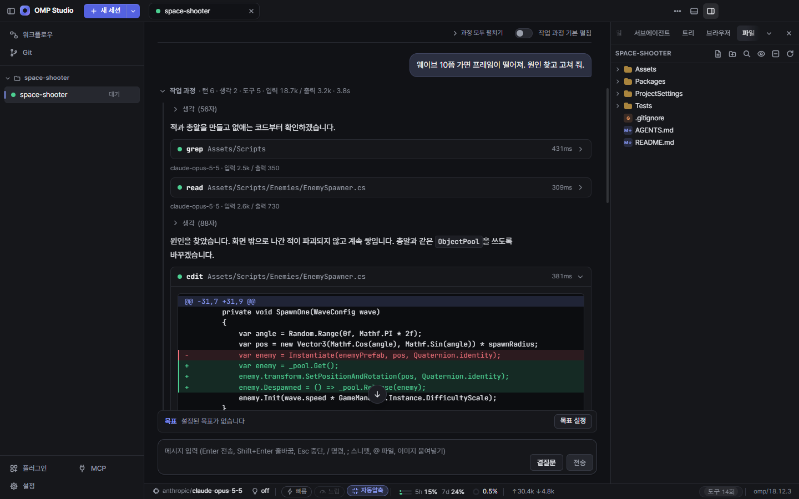
*세션 화면. 에이전트가 읽고(`read`), 찾고(`grep`), 고친(`edit`, diff) 과정이 도구 카드로 남습니다.*

> 스크린샷은 모두 예제 게임 프로젝트(`space-shooter`)로 찍었습니다.

---

## 원하는 대로 바꾸는 앱

OMP Studio의 화면은 플러그인과 같은 등록 구조로 만들어져 있습니다. 사이드바·탭 막대·대화·입력창·상태 표시줄·도크·설정 탭이
모두 id가 있는 "기여물"이라서, 내장 요소를 숨기거나 순서를 바꾸고, 플러그인으로 갈아 끼울 수 있습니다.

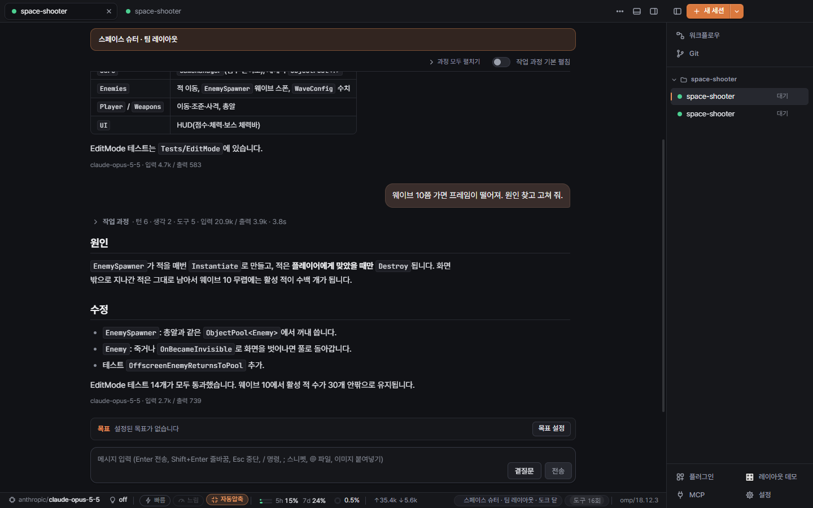
*같은 앱, 다른 모습: 사이드바 오른쪽, 주황색 강조색, 좁은 대화 폭, 플러그인이 붙인 배너·상태 표시줄 항목·사이드바 버튼.
작업 과정은 기본으로 접혀서 최종 답만 보입니다.*

### 화면 구성 — 설정만으로

| 바꿀 수 있는 것 | 내용 |
|---|---|
| 사이드바 | 왼쪽/오른쪽, 너비, 숨기기, 아이콘만 보이는 레일(자동·항상·끄기) |
| 탭 막대·상태 표시줄 | 표시/숨김 |
| 대화 폭 | 최대 너비(px) 또는 전체 폭 |
| 영역별 항목 | 사이드바·입력창 버튼·상태 표시줄·도크 탭·설정 탭 등 19개 영역의 항목을 체크로 숨기고, 끌어서 순서 변경 |
| 레이아웃 프리셋 | 저장된 배치를 한 번에 적용(플러그인이 프리셋을 추가할 수 있음) |
| 컴포넌트 교체 | 같은 컴포넌트를 여러 플러그인이 바꿀 때 어느 것을 쓸지 선택 |

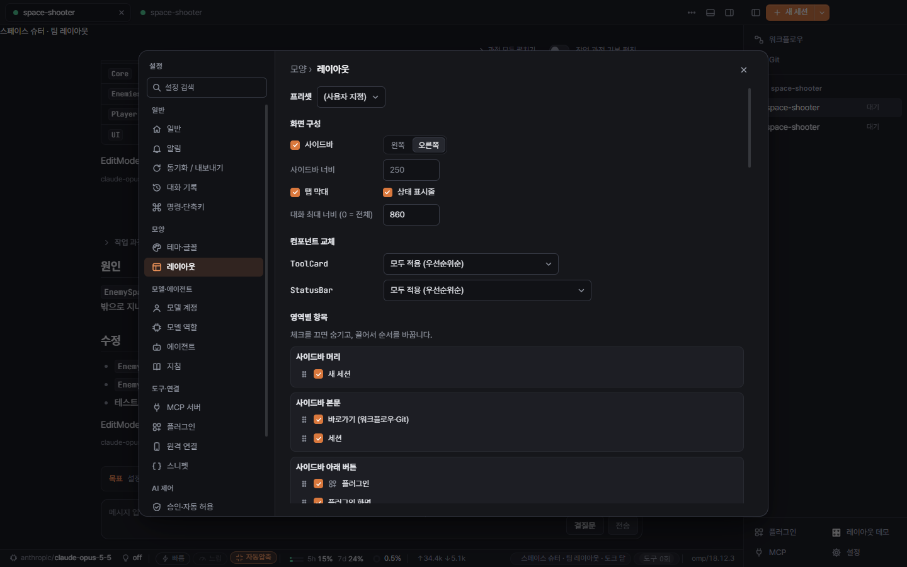
*설정 → 레이아웃. 프리셋, 화면 구성, 컴포넌트 교체, 영역별 항목(숨기기·순서).*

### 테마와 글꼴

- **다크/라이트** 기본 테마 위에 색 하나하나를 **CSS 변수**로 덮어쓸 수 있습니다.
- **사용자 CSS**를 앱 스타일 뒤에 붙일 수 있습니다. 위 스크린샷의 배너 모양도 사용자 CSS입니다.
- UI·대화·코드 **글자 크기**, 대화 줄 간격, UI 글꼴과 코드 글꼴(시스템 글꼴 불러오기)을 바꿉니다.
  대화 글자 크기는 `Ctrl+=` / `Ctrl+-` / `Ctrl+0`으로도 조절됩니다.
- Pretendard·JetBrains Mono·D2Coding 글꼴이 앱에 들어 있습니다.

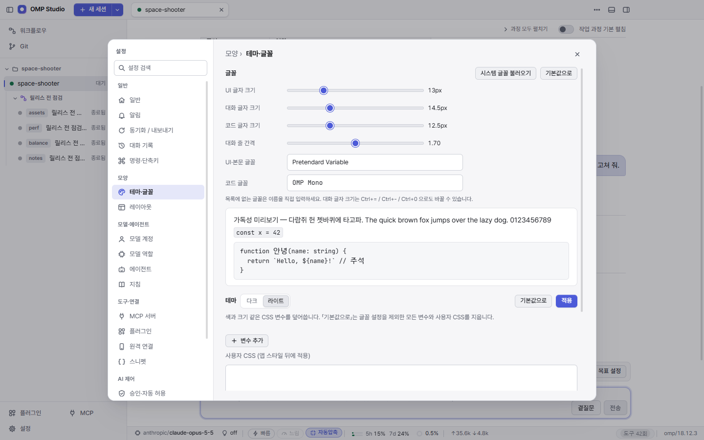
*설정 → 테마·글꼴. 미리보기를 보면서 글꼴과 크기를 고르고, 색 변수와 사용자 CSS를 더합니다.*

### 플러그인 — 기능 추가부터 내장 화면 교체까지

플러그인은 **폴더 하나 + `plugin.json`** 이고 빌드 단계가 없습니다. 파일을 고치고 다시 불러오면 바로 반영됩니다.

| 플러그인이 할 수 있는 일 | |
|---|---|
| 내장 컴포넌트 교체·감싸기 | 사이드바, 탭 막대, 대화 목록, 사용자/AI 메시지, 도구 카드, 입력창, 상태 표시줄, 시작 화면, 세션 화면 |
| 화면 추가 | 전체 화면 뷰, 오른쪽/아래 도크 패널, 상태 표시줄 항목, 입력창 버튼, 설정 탭, 명령 팔레트 명령 |
| 슬롯에 끼워 넣기 | 사이드바 머리/본문/아래, 탭 막대 앞뒤, 대화 앞뒤, 입력창 위/아래 등 19개 슬롯 |
| 레이아웃 | 프리셋 등록, 레이아웃 변경, 항목 숨기기 |
| 에이전트 도구 | 에이전트가 부를 수 있는 호스트 도구(Node 코드, 이미지 결과 가능)와 도구 호출 카드의 전용 뷰 |
| 워크플로우 노드 | 워크플로우 편집기 팔레트에 새 노드 타입 추가(설정 폼은 JSON Schema로 자동 생성) |
| 설정 화면 | `settingsSchema`만 적으면 설정 폼이 자동으로 생기고, 저장할 때 검증됩니다 |
| 세션 연동 | 세션 이벤트 구독, 프롬프트 보내기, omp 명령 실행 |

- 플러그인마다 **켜기/끄기**가 즉시 적용됩니다. 문제가 생기면 **안전 모드**(모든 플러그인 끔)로 다시 시작할 수 있습니다.
- 플러그인은 앱의 React를 그대로 쓰므로 빌드 도구 없이 컴포넌트를 만들 수 있습니다.

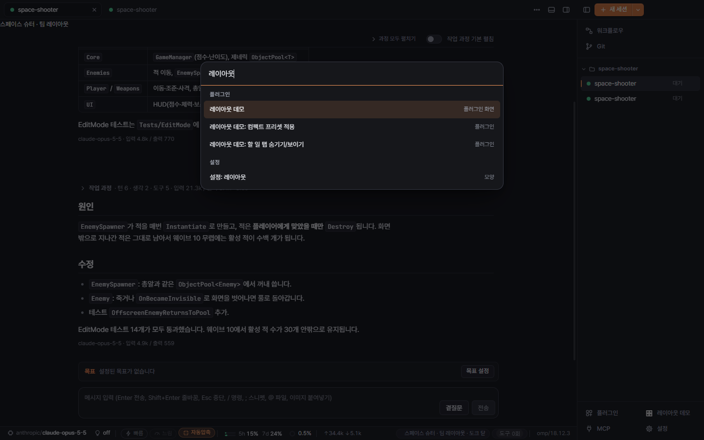
*명령 팔레트(`Ctrl+K`). 플러그인이 등록한 화면·명령과 설정 탭이 한곳에서 검색됩니다.*

### 플러그인 스토어

앱 안에서 공개 플러그인을 찾아 설치합니다. 목록은 **서명을 확인한 뒤에만** 믿고, 패키지는 크기·해시가 맞아야 설치되며,
**새로 설치한 플러그인은 꺼진 상태**로 들어옵니다. 업데이트가 있으면 사이드바 **플러그인** 버튼에 개수가 표시됩니다.

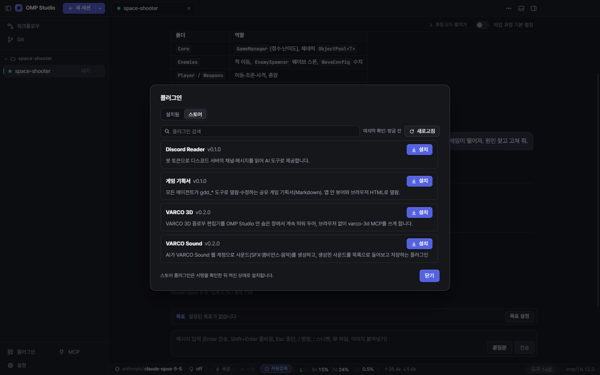
*플러그인 → 스토어. 설치·업데이트·제거를 앱 안에서 합니다.*

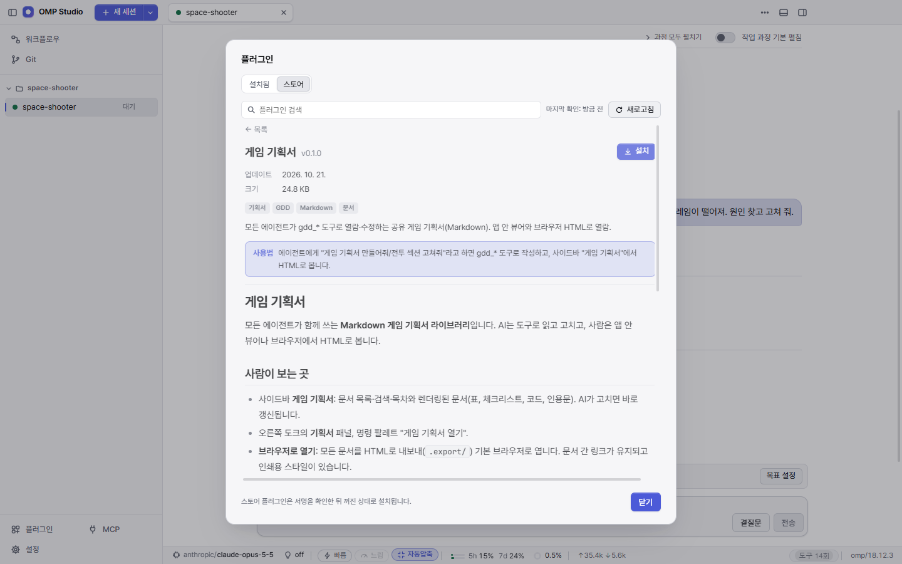
*플러그인 상세. 한 줄 사용법과 README를 설치 전에 읽을 수 있습니다.*

### AI에게 맡겨서 바꾸기

세션 안의 AI는 `studio_*` 도구로 **앱 자체를 바꿀 수 있습니다.** "강조색을 주황색으로 바꾸고 사이드바를 오른쪽으로 옮겨 줘",
"세션 이벤트를 세어서 오른쪽 패널에 보여 주는 플러그인을 만들어 줘" 같은 요청이 그대로 됩니다.

| AI가 다룰 수 있는 것 | 예 |
|---|---|
| 테마·사용자 CSS·레이아웃·플러그인 설정 | 색 변경, 사이드바 위치, 숨길 항목, 프리셋 |
| 플러그인 | 템플릿으로 만들기, 파일 수정, 검증(문법·매니페스트), 다시 불러오기, 로그 보기 |
| 워크플로우·에이전트 | 템플릿으로 생성, 부분 수정, 검증, 모의 실행, 실행 |
| omp 설정·지침·MCP 서버 | `config.yml`, `AGENTS.md` 등, MCP 추가·연결 테스트·OAuth |
| 화면·세션 | 화면·패널 열기, 다른 탭에 일 시키고 결과 받기, 저장된 세션 이어 열기·분기 |
| 내장 브라우저, 컴퓨터 제어(Windows) | 사이트별 승인 / 설정에서 직접 켠 경우에만 |

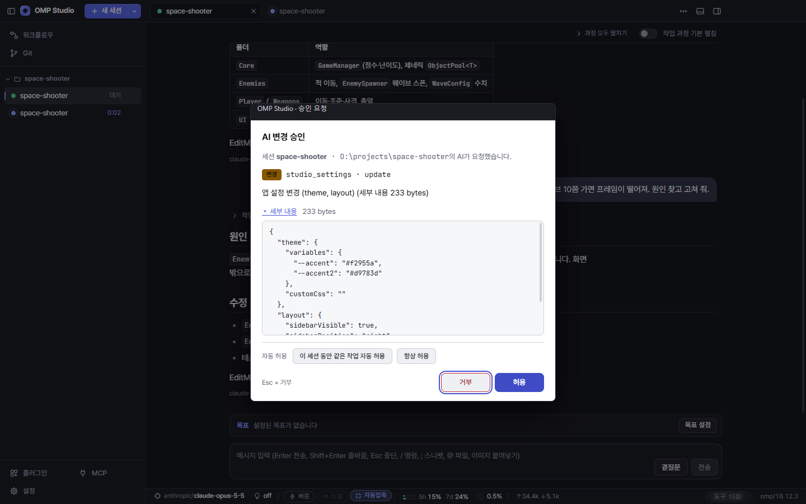
*AI가 앱 설정을 바꾸려 하면 바뀔 내용(JSON)을 보여 주고 승인을 받습니다. 승인 창은 앱 테마·사용자 CSS가 닿지 않는 별도 창으로 뜹니다.*

안전장치:

- **위험 등급별 승인**: 항상 묻기 / 변경만 묻기(기본) / 묻지 않기. "이 세션 동안"·"항상 허용" 같은 자동 허용 규칙도 있습니다.
  10분 동안 답하지 않으면 거부됩니다.
- **변경 기록과 되돌리기**: 바꾸기 전 파일을 백업해 두고, 설정 → AI 변경 기록에서 하나씩 되돌립니다.
  나중에 다른 변경이 같은 파일을 고쳤다면 되돌리기를 거부해 최근 작업을 지킵니다.
- AI가 만든 **플러그인은 꺼진 상태로 생기고**, 켜는 것은 사용자 승인을 거칩니다(켜기 전 파일별 변경 내용 표시).
  AI 제어 설정 자체는 사용자만 바꿀 수 있습니다.
- **플러그인 개발 모드**(기본 꺼짐): AI와 플러그인을 만드는 동안만 켜서, 켜기·다시 불러오기·수정 승인을 자동으로 넘깁니다.

### 내 설정 그대로 옮기기

설정 → 동기화 / 내보내기에서 지금 설정을 **`.ompstudio` 파일** 또는 **`OMPS1.`로 시작하는 코드**로 내보내고,
다른 PC에서 항목별 미리보기·충돌 처리 방식을 고른 뒤 가져옵니다(덮어쓰는 파일은 백업).

---

## 그 밖의 기능

### 세션

- omp 세션 하나가 탭 하나. 탭은 다시 열 때 이어지고, 대화 기록 화면에서 지난 세션을 다시 엽니다. 폴더 없이 쓰는 "일반 대화"도 있습니다.
- **`/resume`**: 입력창에 `/resume`을 치면 저장된 세션을 골라 **지금 탭에서** 이어 엽니다(`/resume <경로 또는 id>`도 됨). 대화는 같은 기록 파일에 이어지고, 바뀐 지침(`AGENTS.md`)은 새로 읽습니다.
  지난 세션을 다시 열지 못하면 빈 탭으로 넘어가지 않고 이유를 보여 줍니다.
- 스트리밍 응답, 생각·도구 호출 카드(명령 출력, 수정 diff). 실행 중인 서브에이전트는 입력창 위 카드에 진행률·지금 하는 일로 보입니다.
- **작업 과정 접기**: 한 번의 요청에서 일어난 생각·도구 호출을 한 줄로 접고(턴·도구 수·토큰·걸린 시간) 최종 답만 보여 줍니다.
- 목표(goal), 곁질문(`/btw`), 대기열·조정 메시지, 스니펫, `@` 파일 첨부, 이미지 붙여넣기, 명령 팔레트, 단축키.
- 지침 파일(`AGENTS.md`, `APPEND_SYSTEM.md`, `SYSTEM.md`) 편집기.

### 워크플로우 (멀티 에이전트)

노드를 이어서 여러 에이전트의 작업 흐름을 만듭니다. 노드 종류: 시작, 에이전트, 합류, 조건, 승인(사람 확인), 출력, MCP 도구,
그리고 플러그인이 추가한 노드(예: 기본 포함된 "명령 실행", "텍스트 조합"). 반복 루프와 병렬 분기를 만들 수 있고 템플릿도 있습니다.

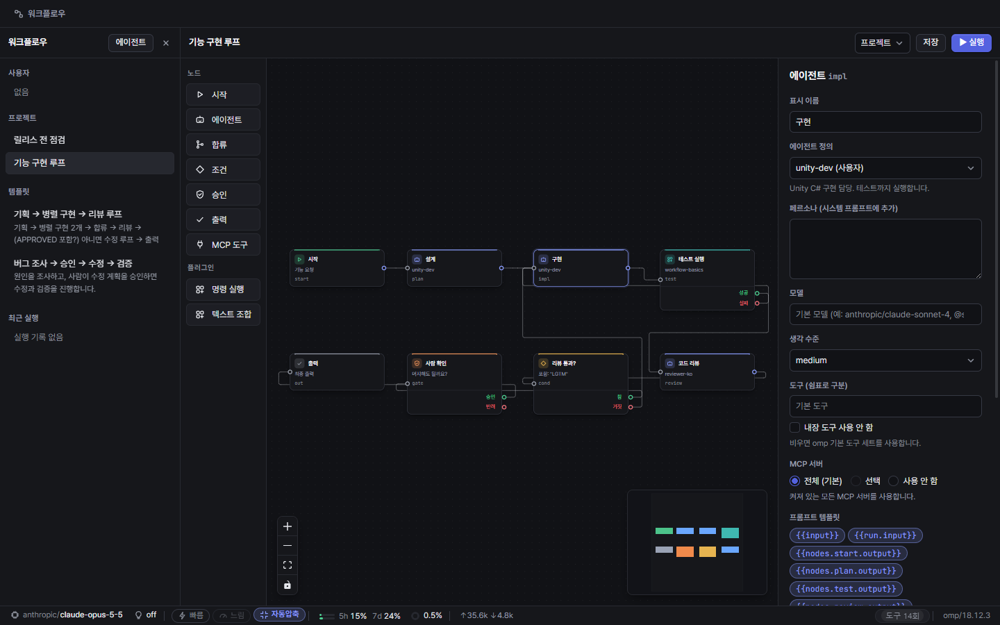
*워크플로우 편집기. 설계 → 구현 → 테스트(플러그인 노드) → 리뷰를 통과할 때까지 반복하고, 마지막에 사람이 확인합니다.*

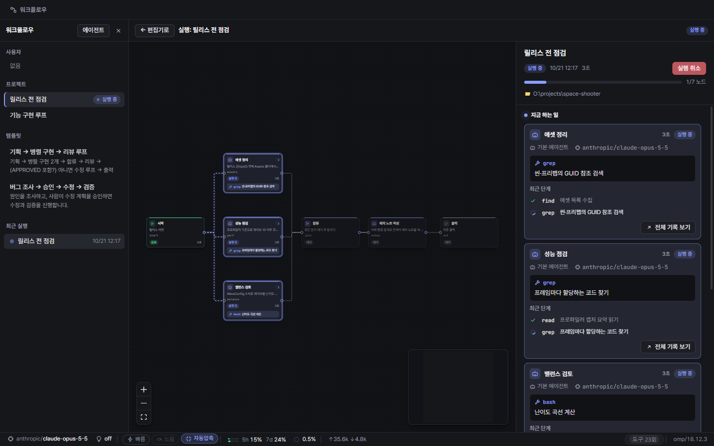
*실행 화면. 세 에이전트가 동시에 일하는 동안 노드별로 "지금 하는 일"과 최근 단계가 보입니다.*

### 작업 공간

| | |
|---|---|
| 오른쪽 패널 | 할 일(진행률) · 기록(트리·체크포인트) · 코드(파일·검색·Git·변경 사항) · 브라우저로 묶인 탭 |
| 터미널 | Windows: PowerShell·cmd·Git Bash·WSL / macOS: 로그인 셸(zsh 등), 여러 탭, 선택 영역을 AI에게 보내기 |
| 파일 | 파일 탐색기, Monaco 편집기, 빠른 열기(`Ctrl+P`), 파일 내용 검색(`Ctrl+Shift+F`), AI 수정 diff 보기 |
| Git | Git 패널(스테이지·커밋 등)과 Git 그래프(브랜치·원격·태그·스태시, 커밋 상세) |
| 브라우저 | 내장 브라우저. AI가 쓸 때는 로그인 정보가 없는 별도 탭에서, 사이트마다 승인을 받고 동작 |

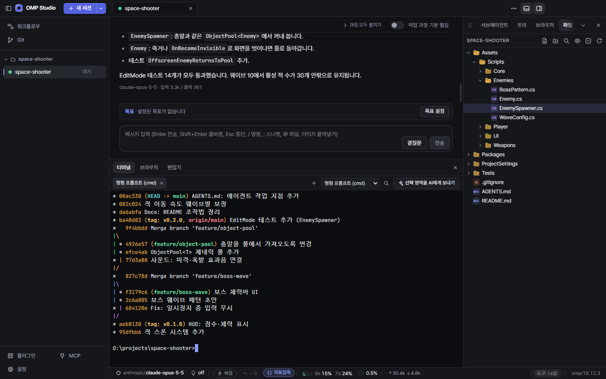
*아래 도크의 터미널과 오른쪽 도크의 파일 탐색기. 편집기·브라우저도 같은 도크에 탭으로 열립니다.*

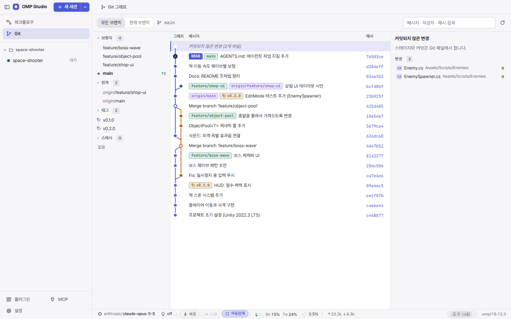
*Git 그래프. 브랜치·원격·태그를 색으로 구분하고, 커밋되지 않은 변경도 맨 위에 보여 줍니다.*

### 연결과 계정

- **MCP 서버** 추가·켜기/끄기·연결 테스트, 브라우저로 하는 MCP OAuth 로그인.
- **모델 계정** 로그인/로그아웃, 모델 역할, **프로바이더 사용량** 표시(상태 표시줄), 사용량이 부족할 때 다른 모델로 넘기는 자동 전환 설정.
- omp 설정 전체를 GUI로 보고 고치는 **omp 설정** 탭과 에이전트 정의 편집기.

### 휴대폰 원격

휴대폰(웹 앱 또는 Android 앱)에서 PC의 세션을 보고, 메시지를 보내고, 승인 요청에 답합니다.
PC는 바깥으로 나가는 릴레이 연결만 쓰고, 내용은 **종단간 암호화**됩니다. 설정 → 원격 연결에서 QR로 연결합니다.

### 알림

작업이 끝나거나 승인이 필요할 때 시스템 알림으로 알려 줍니다. Windows에서는 작업 표시줄 배지와 트레이 아이콘도 씁니다(설정 → 알림에서 조정).

---

## 설치

### Windows

1. [Releases](../../releases/latest)에서 `OMP-Studio-Setup-<버전>.exe`를 받습니다.
2. 실행해서 설치합니다(사용자별 설치, 설치 경로 선택 가능).
   코드 서명이 없어 SmartScreen 경고가 뜨면 **추가 정보 → 실행**을 누르세요.
3. 처음 실행하면 안내 화면이 순서대로 도와줍니다: **omp 설치 → 모델 계정 로그인 → 모델 선택 → 환경 확인 → 기본 설정 → 작업 폴더**.
   omp가 없으면 앱이 내려받아 설치합니다(해시 확인, PATH·환경 변수는 건드리지 않음).
4. 새 버전은 앱이 자동으로 받아 업데이트합니다.

### macOS (서명 없음)

1. [Releases](../../releases/latest)에서 내 Mac에 맞는 파일을 받습니다.
   - Apple Silicon(M1 이후): `OMP-Studio-<버전>-mac-arm64.dmg`
   - Intel: `OMP-Studio-<버전>-mac-x64.dmg`
2. dmg를 열고 **OMP Studio**를 `응용 프로그램` 폴더로 끌어 놓습니다.
3. Apple 서명이 없는 앱이라 처음 한 번은 허용이 필요합니다. 앱을 **우클릭 → 열기**를 누르거나, 터미널에서 다음을 실행하세요.

   ```sh
   xattr -cr "/Applications/OMP Studio.app"
   ```

4. omp를 먼저 설치합니다. macOS에서는 앱이 omp를 대신 설치하지 않습니다([omp 설치 안내](https://github.com/can1357/oh-my-pi#install)).

   ```sh
   curl -fsSL https://omp.sh/install | sh
   # 또는: brew install can1357/tap/omp
   ```

   앱은 PATH와 `~/.local/bin`, `/opt/homebrew/bin`, `/usr/local/bin`, `~/.bun/bin`에서 omp를 찾습니다.
5. 자동 업데이트는 없습니다. 새 버전이 나오면 앱에 "새 버전" 배너가 뜨고, 누르면 릴리스 페이지로 갑니다.

macOS에서 아직 안 되는 것: Studio의 컴퓨터 제어 도구(`studio_computer`)는 Windows 전용입니다. macOS에서는 omp의 `/computer`를 쓰세요.

### 파일 확인 (SHA256)

릴리스 페이지의 각 파일 옆에 SHA256이 표시됩니다. 받은 파일과 비교하려면:

```powershell
Get-FileHash .\OMP-Studio-Setup-<버전>.exe -Algorithm SHA256   # Windows (PowerShell)
```

```sh
shasum -a 256 OMP-Studio-<버전>-mac-arm64.dmg                  # macOS
```

### 요구 사항

| | |
|---|---|
| OS | Windows 10 / 11, macOS(Apple Silicon 또는 Intel) |
| omp CLI | 필요. Windows는 첫 실행 안내에서 설치하고, macOS는 직접 설치합니다 |
| 모델 계정 | omp가 지원하는 모델 제공자의 계정(로그인) 또는 API 키 |
| 선택 | Git(Git 패널·그래프), Unity 등 작업에 쓰는 도구 |

### 제거

- **Windows**: 설정 → 앱 → OMP Studio → 제거. 설정과 데이터(`%APPDATA%\omp-studio`)는 남으니 필요하면 직접 지우세요.
- **macOS**: `응용 프로그램`에서 OMP Studio를 휴지통으로 옮깁니다. 설정과 데이터(`~/Library/Application Support/omp-studio`)는 남습니다.

omp와 omp의 설정(`~/.omp`)은 OMP Studio와 별개라 함께 지워지지 않습니다.

---

## 자주 묻는 질문

**데이터는 어디에 저장되나요?**
내 PC에 저장됩니다. 앱 설정·플러그인·AI 변경 기록과 백업은 `%APPDATA%\omp-studio`(macOS: `~/Library/Application Support/omp-studio`), 세션 기록과 모델 계정 정보는 omp 쪽(`~/.omp`)에 있습니다.
휴대폰 원격은 릴레이를 거치지만 종단간 암호화되어 릴레이는 내용을 볼 수 없습니다.

**비용이 드나요?**
OMP Studio는 무료입니다. 모델 사용 비용은 **내가 로그인한 모델 계정**의 요금제·사용량을 따릅니다. 상태 표시줄에서 사용량을 확인할 수 있습니다.

**AI가 내 PC에서 마음대로 무언가를 하지 않나요?**
에이전트의 파일·명령 실행은 omp의 동작을 따르고, 앱을 바꾸는 `studio_*` 도구는 위의 승인 체계를 거칩니다(기본: 변경할 때마다 묻기).
바뀐 것은 변경 기록에 남고 되돌릴 수 있으며, 설정 → 승인·자동 허용에서 AI 제어를 통째로 끌 수도 있습니다.
컴퓨터 제어는 직접 켜야만 쓸 수 있고, 입력 동작은 매번 승인을 받습니다.

**플러그인은 안전한가요?**
플러그인은 앱 안에서 코드로 실행되므로 믿을 수 있는 것만 켜세요. 스토어 플러그인은 서명·해시를 확인하고 꺼진 상태로 설치되며,
문제가 있으면 안전 모드로 시작한 뒤 해당 플러그인만 끄면 됩니다.

**Oh My Pi 공식 프로젝트인가요?**
아닙니다. OMP Studio는 omp(Oh My Pi)를 사용하는 **비공식 GUI**이며, omp 개발사(Stencil Labs)와 관련이 없습니다.

---

## 이용 조건

[`LICENSE.md`](LICENSE.md)를 보세요. 요약: 개인·업무용으로 무료로 쓸 수 있고, 재배포·수정·판매는 할 수 없습니다.

## 오픈소스 고지

OMP Studio는 별도로 설치되는 [Oh My Pi (omp)](https://github.com/can1357/oh-my-pi)를 실행해 동작합니다. omp는 MIT 라이선스로 배포됩니다.

```text
MIT License

Copyright (c) 2025 Mario Zechner
Copyright (c) 2025-2026 Can Bölük
Copyright (c) 2026 Stencil Labs, Inc.
```

전문: https://github.com/can1357/oh-my-pi/blob/main/LICENSE
